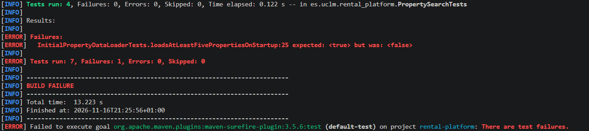

# TEST_PLAN — Plan de Pruebas del Proyecto


> **Ingeniería del Software II · Laboratorio 2026-2027**  

> Este documento recoge la estrategia global de pruebas del proyecto y se actualiza progresivamente durante las sesiones S6–S8 y el resto del desarrollo.

>

> **Es un único documento para todo el proyecto.** No debe duplicarse por cada issue, historia de usuario o prueba. Los casos y pruebas relevantes se registran de forma resumida en las tablas y solo se documentan con mayor detalle cuando exista una decisión, carencia, defecto o evidencia especialmente significativa.

>

> El objetivo no es maximizar el número de tests ni alcanzar un porcentaje aislado de cobertura, sino comprobar comportamientos relevantes mediante pruebas comprensibles, reproducibles y capaces de detectar defectos.


---


## 1. Identificación


**Equipo / empresa:**  Groundbnb
**Repositorio:** github.com/NCVN06/Groundbnb
**Versión del documento:** 0.5  
**Responsable de mantener el plan:** Pedro Jesús
**Sprint / iteración actual:** 7  
**Última actualización:** 18/11/2026


---


## 2. Estrategia general de pruebas


### Objetivo


> Indicar brevemente qué pretende conseguir el equipo con las pruebas automatizadas y qué comportamientos considera prioritario proteger.


### Prioridades actuales


Flujos funcionales críticos.
Reglas de negocio relevantes.
Validaciones y errores controlados.
Persistencia y consultas significativas.
Comportamientos propensos a fallo.
Funcionalidades modificadas o susceptibles de regresión.


### Tipos de prueba utilizados


| Tipo | Cuándo se utiliza | Ejemplos en el proyecto |

| Unitaria | Para comprobar una clase, método o regla de negocio de forma aislada | FP-01 |

| Integración | Para comprobar la colaboración entre varios componentes o con persistencia | FP-02 |

| Web / controlador | Para comprobar rutas, formularios o respuestas cuando aporte valor |  |


> El equipo no tiene que utilizar todos los tipos de prueba en todas las funcionalidades. Debe seleccionar el nivel de prueba adecuado al comportamiento que quiere proteger.


---


## 3. Funcionalidades y comportamientos prioritarios


> Registrar aquí los principales flujos o comportamientos que el equipo considera relevantes para probar. No es necesario incluir todas las issues del proyecto.


| ID | Funcionalidad / comportamiento | Issue o requisito relacionado | Motivo de prioridad | Estado de pruebas |

| FP-01 | Alta de prioridades propiedades  | 13 | Comprobar la funcionalidad básica de creación de propiedades | Cubierto |

| FP-02 | Buscar propiedades | 11 | Comprobar la recuperación de información con mediante la funcionalidad de búsqueda | Cubierto  |

| FP-03 | Inicializar programa con datos cargados | 35 | Comprobar que la web muestre las propiedades | Cubierto  |


---


## 4. Catálogo de casos de prueba


> Los casos se diseñan primero en lenguaje natural. Después, cuando proceda, se automatizan con JUnit.


| ID | Funcionalidad | Criterio protegido | Tipo de caso | Entrada / situación | Resultado esperado | Prioridad |

| CP-01 | FP-01 | Las propiedades deben tener un nombre, una descripción, su dirección, el precio por noche y las comodidades que ofrece. | Válido | Rellenamos los campos con valores validos para crear una propiedad  | Se crea la propiedad | Alta |

| CP-02 | FP-01 | Deben tener un nombre, una descripción, su dirección, el precio por noche y las comodidades que ofrece | Inválido | Rellenamos los campos con valores incorrectos al crear la vivienda | El sistema informa que los datos introducidos no son correctos | Alta |

| CP-03 | FP-02 | El sistema debe devolver y mostrar el listado de propiedades resultantes que coincidan con la búsqueda
 | Valido | Introducimos los datos de una propiedad que existe en la base de datos | Se recupera la información de la propiedad | Alta |

| CP-04 | FP-03 | El sistema debe mostrar al menos cinco propiedades en la pestaña de inicio de la aplicción
 | Regresión | Hay datos cargados en la base de datos | Se recupera la información | Baja |
 
| CP-05 | FP-01 | Las propiedades deben tener un precio por noche
 | Valido | Introducimos un valor valido en el campo de precio por noche | Se crea la propiedad | Alta |

| CP-06 | FP-01 | Las propiedades deben tener un precio por noche
 | Limite | Introducimos un valor limite en el campo de precio por noche | Se crea la propiedad | Media |

| CP-07 | FP-01 | Las propiedades deben tener un precio por noche
 | Invalido | Introducimos un valor invalido en el campo de precio por noche | No se crea la propiedad | Alta |

| CP-08 | FP-01 | Las propiedades pueden tener de manera opcional una dirección extendida 
 | Valido | Introducimos los datos en los campos opcionales de dirección | Se crea la propiedad | Media |


### Convención


**Válido:** comprueba comportamiento esperado con datos correctos.
**Inválido:** comprueba que una entrada o situación incorrecta se trata de forma controlada.
**Límite:** comprueba valores frontera o casos especialmente sensibles.
**Regresión:** protege un comportamiento ante cambios futuros.


---


## 5. Particiones de equivalencia y valores límite


> Utilizar esta sección únicamente en los comportamientos donde estas técnicas aporten valor. No es necesario rellenarla para cada prueba.


### Particiones de equivalencia


| Dato / condición | Partición válida | Partición inválida | Casos asociados |

| Precio por noche | 50.00 | 0.00 | CP-05  | 


### Valores límite


| Dato / condición | Valores límite relevantes | Comportamiento esperado | Casos asociados |

| Precio por noche | 0.01 | Se acepta el valor introducido | CP-06 |


---


## 6. Pruebas automatizadas implementadas


> Relacionar los casos diseñados con las pruebas JUnit existentes. Una prueba puede cubrir uno o varios casos relacionados si está justificado.


| ID caso | Clase / método JUnit | Tipo | Comportamiento protegido | Estado |


| CP-01 | `PropertyRegistrationTests.shouldCreatePropertyWhenDataIsValid` | Integración | Registra y persiste una propiedad con datos válidos | Implementada |

| CP-02 | `PropertyRegistrationTests.shouldRejectPropertyWhenDataIsInvalid` | Integración | Rechaza un formulario incompleto y no crea una propiedad | Implementada |

| CP-03 | `PropertySearchTests.shouldReturnPropertyWhenExists` | Integración / Web | Recupera la propiedad coincidente y excluye propiedades que no coinciden | Implementada |

| CP-04 | `InitialPropertyDataLoaderTests.loadsAtLeastFivePropertiesOnStartup` | Web | Muestra el catalogo de ejemplo en la web | Implementada |

| CP-05 | `PropertyPricePerNight.shouldAcceptPricePerNightWhenDataIsValid` | Unitaria | Registra una propiedad con un valor valido | Implementada |

| CP-06 | `PropertyPricePerNight.shouldAcceptPricePerNightWhenDataIsLimitValue` | Unitaria | Registra una propiedad con un valor límite | Implementada |

| CP-07 | `PropertyPricePerNight.shouldRejectPricePerNightWhenDataIsInvalid` | Unitaria | Introduce un valor invalido en precio por noche |

| CP-08 | `PropertyAddresTest.shouldReturnPropertyWhenExists` | Integración | Registra una propiedad con una dirección extendida | Implementada |


### Criterios de diseño


Las pruebas implementadas deberían, cuando resulte aplicable:


seguir una estructura comprensible **Arrange – Act – Assert**;
tener nombres descriptivos;
utilizar datos de prueba claros;
contener aserciones significativas;
comprobar un objetivo entendible;
fallar cuando se rompe el comportamiento protegido;
evitar dependencias innecesarias de detalles internos;
ser repetibles desde Maven.


---


## 7. Revisión de calidad de las pruebas


> Esta sección sirve para revisar el conjunto de pruebas, no para crear una ficha por cada test.


### Checklist general


[x] Las pruebas están relacionadas con requisitos, criterios o comportamientos relevantes.
[x] Existen casos válidos, inválidos y límite cuando corresponda.
[x] Las aserciones comprueban resultados significativos.
[x] Las pruebas pueden fallar ante defectos reales relacionados con el comportamiento protegido.
[X] No existen pruebas vacías o que siempre pasen.
[X] No se mezclan demasiados objetivos no relacionados en una misma prueba.
[X] Se han detectado y corregido pruebas frágiles cuando ha sido necesario.
[X] El equipo comprende qué protege cada prueba relevante.
[X] Las pruebas pueden ejecutarse de forma reproducible con Maven.

### Pruebas frágiles, débiles o poco significativas detectadas


| Prueba | Problema detectado | Decisión | Estado |

| CP-01 | No puede comprobr valores límite ni negativos  | Dividir | Resuelto |

| CP-01 | No comprueba los parametros opcionales | Dividir | Resuelto |


---


## 8. Defecto deliberado — Evidencia S6


> Durante S6 el equipo debe introducir de forma controlada al menos un defecto para comprobar si una prueba es capaz de detectarlo.


**Prueba seleccionada:** (src/main/test/java/es/uclm/rental_platfom/InitialPropertyDataLoaderTests.java)
**Comportamiento protegido:** Comprobar que la persistencia simulada funciona creando 5 propiedades al arrancar el programa. 
**Defecto introducido:** Crear solo 4 propiedades en vez de 5.
**Resultado esperado:**  Debe fallar al realizar la comprobación "assertTrue(homes=>5)".
**¿La prueba falló?:** Sí. 
**Corrección realizada:** Implementar nuevamente la propiedad eliminada.
**Resultado después de corregir:**  BUILD SUCCESS


### Evidencia de ejecución


```powershell

.\mvnw.cmd test

.\mvnw.cmd verify

```


**Resultado antes del defecto:** BUILD SUCCESS
**Resultado con el defecto:**  BUILD FAILURE
**Resultado tras la corrección:**  BUILD SUCCESS


> La finalidad no es romper el proyecto sin motivo, sino demostrar que la prueba puede detectar el defecto que afirma proteger.


---


## 9. Ejecución reproducible del conjunto de pruebas


### Comandos de referencia


```powershell

.\mvnw.cmd test

.\mvnw.cmd verify

```


### Estado actual


[X] El conjunto de pruebas puede ejecutarse desde Maven.
[X] El build completo finaliza correctamente.
[X] Los fallos existentes están identificados y documentados.
[X] No existen pruebas deshabilitadas o eliminadas únicamente para obtener un build verde.


### Última ejecución


**Fecha:** 18-11-2026  
**Resultado:**  BUID SUCCESS
**Incidencias:**  Ninguna

---


## 10. Verificación y relación con cobertura y calidad


> Esta sección se completa progresivamente durante S7 y S8.

>

> **Importante:** la cobertura y Sonar aportan evidencias complementarias, pero no sustituyen el diseño de buenos casos de prueba. El **Hito 2** se cierra en **S7** con pruebas y verificación automatizada; Sonar pertenece a la dimensión de **Calidad** y prepara información para el mantenimiento posterior.


### 10.1 Verificación — S7 · Maven y Surefire


> Registrar aquí la evidencia mínima de que el conjunto de pruebas puede ejecutarse de forma reproducible fuera del IDE.


**Fecha de verificación:**  
**Rama / commit verificado:**  
**Comandos ejecutados:**


```powershell

.\mvnw.cmd test

.\mvnw.cmd verify

```


**Resultado de `test`:**  
**Resultado de `verify`:**  
**Número de tests ejecutados:**  
**Fallos o errores relevantes:**  
**Informe Surefire revisado:** `target/surefire-reports/`  
**Evidencia / enlace:**  


### 10.2 Cobertura — S7 · JaCoCo


**Informe generado:** `target/site/jacoco/index.html`  
**Cobertura observada de forma global:**  
**Clase / paquete / comportamiento revisado:**  
**Zonas importantes con cobertura insuficiente:**
  -

  -


**Ramas o casos relevantes no ejercitados:**
  -

  -


**Justificación de zonas no cubiertas cuando proceda:**
  -

  -


> No se exige perseguir un porcentaje concreto por sí mismo. La cobertura debe interpretarse en relación con comportamientos, requisitos, casos de prueba y riesgos reales.


### 10.3 Interpretación y decisión — S7


> La cobertura debe provocar una decisión técnica explícita, aunque la decisión sea no añadir ninguna prueba.


**Carencia o riesgo detectado:**  
**Caso(s) del plan afectados:**  
**Decisión:** Añadir prueba / Mejorar prueba / Mantener sin cambios / Justificar no cobertura  
**Cambio realizado:**  
**Motivo:**  
**Resultado tras repetir `test` / `verify`:**  
**Relación con AI-02, si procede:**  
**Evidencia / enlace:**  


### 10.4 Sonar — S8 · Contexto para nuevas necesidades de prueba


Problemas o incidencias que sugieren añadir o revisar pruebas:
  -

  -


Pruebas añadidas o modificadas como consecuencia del análisis de calidad:
  -

  -


> **La cobertura no se interpreta como un objetivo aislado.** Debe relacionarse con requisitos, casos de prueba, defectos que se pretende detectar y zonas relevantes del código.


---


## 11. Pendientes y evolución del plan


| Pendiente / mejora | Motivo | Prioridad | Responsable | Estado |

|---|---|---|---|---|

|  |  |  |  | Pendiente |

|  |  |  |  | Pendiente |


El plan debe actualizarse cuando:


se incorporen nuevas funcionalidades relevantes;
cambien criterios o reglas de negocio;
se detecten defectos significativos;
se añadan o eliminen pruebas importantes;
se detecten pruebas frágiles;
JaCoCo muestre zonas relevantes no ejercitadas;
la verificación S7 produzca una decisión sobre añadir, mejorar o justificar pruebas;
Sonar revele nuevas necesidades de verificación;
cambie la estrategia de pruebas del equipo.


---


## 12. Resumen del estado de pruebas


> Completar en 3–5 líneas y mantenerlo actualizado.


**Principales comportamientos protegidos:**  
**Pruebas automatizadas relevantes:**  
**Carencias actuales:**  
**Próxima prioridad de pruebas:**  
**Estado general:** Pendiente / En progreso / Suficiente para la iteración 